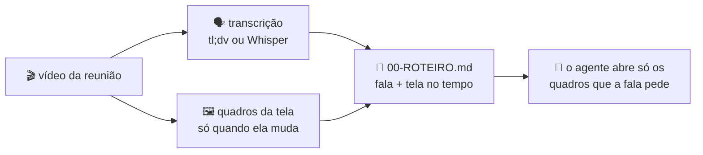

<div align="center">

# 🎬 transcrever-video

**Transcrição + quadros da tela, para o Claude Code entender o que foi *dito* e o que foi *mostrado* numa reunião gravada.**

Aponte o vídeo. A skill transcreve a fala, guarda um quadro cada vez que a tela muda (inclusive quando alguém mexe o mouse para apontar algo) e monta um roteiro ligando cada fala ao quadro certo.


</div>

---

## Por que existe

Em reunião de levantamento de requisito, metade da explicação é visual:

> *"Tá vendo essa coluna aqui? Quando fica vermelho é porque travou no financeiro."*

A transcrição sozinha guarda a frase, mas não diz **qual** coluna. Quem lê depois (você daqui a uma semana, ou o agente que vai implementar) fica sem a parte que importa.

Esta skill resolve isso sem mandar nada para a nuvem. Ela transforma o vídeo numa pasta que dá para ler: a fala com marcação de tempo e a tela, quadro a quadro, nomeada pelo segundo em que apareceu. O agente lê o roteiro e abre **só** as imagens de que precisa.

## ⚙️ Como funciona



## ✨ Destaques

| | |
|---|---|
| 🖱️ **Pega o mouse** | O limiar é baixo de propósito: ponteiro apontando, célula selecionada e tooltip geram quadro. É assim que quem apresenta mostra o que está explicando. |
| 👥 **Ignora os participantes** | O quadradinho de quem está na chamada, a borda que acende em quem fala e o anel animado do avatar mudam o tempo todo. A skill descobre sozinha essas regiões, layout por layout, e tira da comparação. |
| 🗂️ **Quadro com nome de tempo** | `reuniao_000116.jpg` é o que estava na tela em 00:01:16. Ordena certo no Explorer e bate com a transcrição. |
| 📍 **Diz onde mudou** | Cada quadro vem classificado (tela nova, mudança parcial, mouse/detalhe) e com a região da imagem em que a mudança aconteceu. O agente sabe para onde olhar. |
| 🗣️ **Aproveita a transcrição que você já tem** | Se houver um `.txt` exportado do tl;dv ao lado do vídeo, ele é usado (com o nome de quem falou). Sem ele, roda o Whisper local. |
| 🔒 **100% local** | Vídeo de cliente não sai da máquina. Sem API, sem upload. Só o download inicial do modelo Whisper usa a internet. |
| 📦 **Sem ffmpeg para instalar** | O PyAV já traz o ffmpeg embutido. Lê `.ts`, `.mp4`, `.mkv`, `.webm`, `.mov`, `.avi`. |

## 📂 O que ele gera

Ao lado do vídeo nasce uma pasta com o nome dele:

```text
reuniao_vendas.mp4
reuniao_vendas/
├── 00-ROTEIRO.md          ← comece por aqui: a fala com as mudanças de tela intercaladas
├── 00-TRANSCRICAO.txt     ← transcrição normalizada em [HH:MM:SS]
├── 00-INDICE.json         ← tudo em formato de máquina (quadros, falas, parâmetros)
├── reuniao_vendas_000000.jpg
├── reuniao_vendas_000214.jpg
├── reuniao_vendas_000215.jpg
└── ...                    ← um quadro por mudança de tela
```

Trecho de um `00-ROTEIRO.md`:

```markdown
### [00:04:12] Ana Souza
Aí nessa tela de pedidos, tá vendo essa coluna de status? Quando fica vermelho é porque travou no financeiro.
- tela vigente: reuniao_vendas_000358.jpg
- 00:04:14 mouse/detalhe em x612-668 y288-302 -> reuniao_vendas_000414.jpg
- 00:04:17 mudanca parcial em x20-905 y190-560 -> reuniao_vendas_000417.jpg

### [00:04:25] Carlos Lima
Então o filtro de data fica aqui em cima?
- 00:04:26 TELA NOVA (41% da area) -> reuniao_vendas_000426.jpg
```

Lendo isso, o agente sabe que a "coluna de status" está no quadro `000414`, perto de x=640, y=295, e abre só ele.

## 🚀 Instalação

### 1. Clonar na pasta de skills do Claude Code

```bash
git clone https://github.com/Fabiano-Couto/transcrever_video.git ~/.claude/skills/transcrever-video
```

> O nome da pasta precisa ser **`transcrever-video`**, igual ao `name` do `SKILL.md`.

### 2. Criar o ambiente Python

O venv fica dentro da própria skill e não vai para o repositório.

**Windows (PowerShell)**

```powershell
cd $HOME\.claude\skills\transcrever-video
python -m venv venv
.\venv\Scripts\python.exe -m pip install -r requirements.txt
```

**Linux / macOS**

```bash
cd ~/.claude/skills/transcrever-video
python3 -m venv venv
./venv/bin/python -m pip install -r requirements.txt
```

Pronto. Na próxima sessão do Claude Code a skill aparece na lista. Os caminhos do `SKILL.md` são relativos à pasta da skill, então não há nada para ajustar.

## 💬 Como usar

### Pelo Claude Code

É só citar o vídeo na conversa:

> *"Assiste a gravação em `C:\Reunioes\kickoff.mp4` e me diz quais colunas o cliente pediu no relatório."*
>
> *"Na reunião de ontem, o que ele mostrou quando falou do filtro de data?"*

O Claude processa o vídeo, lê o roteiro, abre os quadros dos momentos em que a fala depende da tela e responde juntando as duas coisas. Antes de agir, ele mostra o trecho da fala e o que viu, para você conferir nomes e números.

### Arrastando o vídeo (Windows)

Arraste um ou mais vídeos em cima do **`TRANSCREVER_VIDEO.bat`**, ou de um atalho para ele na área de trabalho. A pasta fica pronta para você apontar ao Claude depois.

### Direto pelo terminal

```bash
venv/Scripts/python.exe transcrever_video.py "caminho/da/reuniao.mp4"
```

```text
[quadros] leitura 1/2: procurando regioes que mudam o tempo todo ...
[quadros] leitura 2/2: salvando quando a tela muda ...
[transcricao] usando a que ja existe: reuniao_vendas_transcricao.txt
Pasta: C:\Reunioes\reuniao_vendas
Duracao: 00:17:38
Quadros: 386 salvos de 1059 instantes (tela nova 6, parcial 89, mouse/detalhe 290)
Transcricao: arquivo reuniao_vendas_transcricao.txt (85 falas)
Ignorado de 00:01:10 a 00:17:39: [[912, 0, 1280, 688]]
```

### Opções

| Flag | Padrão | Para que serve |
|---|---|---|
| `--intervalo` | `1` | De quantos em quantos segundos olhar a tela |
| `--limiar` | `20` | Pontos alterados para salvar quadro. Menor = mais sensível |
| `--todos` | desligado | Salva todos os instantes, sem descartar repetidos |
| `--sem-mascara` | desligado | Não ignora as regiões dos participantes |
| `--transcricao` | `auto` | `auto` (arquivo ao lado do vídeo, senão Whisper), `whisper`, `nenhuma` ou o caminho de um `.txt` |
| `--modelo` | `large-v3-turbo` | Modelo do Whisper (`small`, `medium`, `large-v3`...) |
| `--idioma` | `pt` | Idioma do Whisper |
| `--formato` / `--qualidade` | `jpg` / `90` | Formato e qualidade dos quadros |
| `--pasta` | ao lado do vídeo | Outra pasta de saída |
| `--refazer` | desligado | Não reaproveita a transcrição da rodada anterior |
| `--quadro HH:MM:SS ...` | - | Só extrai o quadro exato desses instantes, em PNG |

## 🧠 Como a detecção de mudança funciona

1. **Primeira leitura do vídeo.** A cada segundo, a imagem é reduzida para 640 px de largura em tons de cinza e comparada com a anterior. A skill conta, ponto a ponto, com que frequência cada região muda. O que muda em mais de 10% dos instantes é ruído: participante da chamada, borda de quem fala, avatar animado. O grupo inteiro vira um retângulo ignorado.
2. **Por trecho de layout.** Quando mais de 35% da tela muda de uma vez (começou o compartilhamento, por exemplo), os participantes mudam de lugar. A estatística recomeça a partir dali, e cada trecho tem suas próprias regiões ignoradas.
3. **Segunda leitura.** Cada instante é comparado com o **último quadro salvo**. Se mais de 20 pontos mudaram fora das regiões ignoradas, o quadro é gravado na resolução original. Como a comparação é com o último salvo, uma sequência de mudanças pequenas acaba somando e gerando quadro.
4. **Classificação.** Acima de 20% da área útil é *tela nova*; acima de 1%, *mudança parcial*; abaixo disso, *mouse/detalhe*. A região da mudança vai junto, em pixels do vídeo.

Na prática, numa reunião de 17min38s em 720p com Excel e sistema compartilhados, os quadros saíram em cerca de 50 segundos numa CPU comum: 386 de 1.059 instantes (uns 50 MB), sem perder nenhuma troca de tela nem os momentos de mouse apontando.

## ⚠️ Limitações conhecidas

- **Resolução do vídeo.** Gravação em 720p deixa texto pequeno difícil de ler. O `--quadro` em PNG ajuda (sem compressão), mas não cria detalhe que o vídeo não tem.
- **O Whisper não separa quem fala.** Se quem falou importa, exporte a transcrição da ferramenta de reunião (tl;dv, Teams, Zoom) e deixe ao lado do vídeo com o nome começando igual.
- **Falso positivo é esperado, de propósito.** Prefere-se quadro sobrando a perder o momento em que alguém apontou algo. O agente só abre o que a fala pede.
- **Velocidade do Whisper em CPU:** de metade ao tempo total do vídeo. Os quadros são rápidos.

## 📁 Estrutura

```text
transcrever-video/
├── SKILL.md               # o que o Claude Code lê: quando disparar e como usar o resultado
├── transcrever_video.py   # linha de comando
├── nucleo/                # o motor, sem dependência de terminal nem do Claude
│   ├── quadros.py         #   leitura do vídeo, regiões ignoradas, detecção de mudança
│   ├── transcricao.py     #   leitor de tl;dv / faixas de tempo e o Whisper
│   ├── roteiro.py         #   00-ROTEIRO.md e 00-INDICE.json
│   └── tempo.py
├── TRANSCREVER_VIDEO.bat  # arrastar e soltar no Windows
├── requirements.txt
└── venv/                  # ambiente local (fora do git)
```

O `nucleo/` recebe caminho e parâmetros e devolve dados. Dá para importar o mesmo motor num backend web, e o `00-INDICE.json` já é o formato que uma página consome para desenhar a linha do tempo.

## 🔗 Relacionado

- **[transcrever-audio-pt-br](https://github.com/Fabiano-Couto/transcrever-audio-pt-br)**: a skill irmã, para áudio puro (WhatsApp, recado de voz).

## 🙏 Créditos

- [PyAV](https://github.com/PyAV-Org/PyAV): leitura do vídeo, com o ffmpeg embutido
- [faster-whisper](https://github.com/SYSTRAN/faster-whisper), da SYSTRAN, sobre o [Whisper](https://github.com/openai/whisper) da OpenAI: a transcrição
- [Claude Code](https://docs.claude.com/en/docs/claude-code), da Anthropic: onde a skill roda

<div align="center">

Feito por **[Fabiano Couto](https://github.com/Fabiano-Couto)** · hero1

</div>
